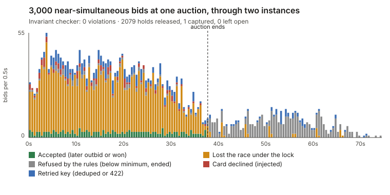

# Holdfast

Real-time auctions where a bid counts only once a Stripe authorization hold covers it. Bids are ordered in a Postgres transaction and every bidder sees updates live. A load test of near-simultaneous bids proves the ordering holds, and one bid can be traced end to end.

**Live demo:** https://holdfast-production-ba968615.up.railway.app (Stripe test mode: use card 4242 4242 4242 4242; no real money moves).

**Status:** slice 6b of 7 (observable: one bid traced end to end across both instances; alerts on orphaned holds, outbox failures and capture failures, each fired once on purpose; see [docs/runbook.md](docs/runbook.md)). Deployed on Railway with two replicas ([docs/deploy.md](docs/deploy.md)); two people in two browsers can bid against each other and see every change live; each bid places a real test-mode card hold. Design: [docs/spec.md](docs/spec.md) and [docs/adr/](docs/adr/). Stripe test mode only; no real money moves.

## Correct under load



Two hundred bidders sent 3,000 bids at one auction in about 74 seconds, through two server instances and Redis on a laptop. Most of them chased a price that had already moved and lost the race under the row lock, as they should. Afterwards the invariant checker found **zero violations**: every accepted bid was covered by a hold and strictly higher than the last, nothing was accepted after the auction ended, no retry made a second bid or hold, and all 2,079 losing holds were released with the winner's captured.

Throughput, honestly: the run peaked at about 110 bids a second (55 in the busiest half second), with a median response of about 320ms and a 95th percentile of about 530ms. Most of that time is the simulated card hold, which takes 150–500ms (ADR 0006: load runs use a Stripe fake, since Stripe's test mode allows about 25 requests a second). The bids are paced to straddle the auction's end, so this is a correctness test under heavy contention, not a measurement of the ceiling. CI runs a smaller storm with the same checker on every PR.

## Local development

Needs Node.js 26 (see `.nvmrc`), corepack, and Docker.

```bash
fnm use                      # or nvm use: Node 26 from .nvmrc
corepack enable              # pnpm at the version in package.json
pnpm install
cp .env.example .env.local   # placeholders for local Postgres and Redis
docker compose up -d --wait  # Postgres and Redis
pnpm db:migrate
pnpm seed                    # two demo auctions; safe to run again
```

Checks, as CI runs them:

```bash
pnpm lint && pnpm format:check && pnpm typecheck
pnpm test:unit               # auction rules, no Docker needed
pnpm test:integration        # starts its own Postgres with Testcontainers
```

The real Stripe suite is by hand, never in CI. Put a test-mode key (`sk_test_…`) in `.env.local` as `STRIPE_SECRET_KEY`, then:

```bash
pnpm test:live               # real holds in your Stripe sandbox; skips without a key
```

The page on http://localhost:5173, with two server instances behind a round-robin proxy on :3000. It uses the Stripe fake unless `.env.local` has test keys; with `DEV_SIGN_IN=1` the page offers a dev sign-in, no GitHub app needed:

```bash
pnpm dev
```

End to end, as CI runs it (the fake), and the real-card flow by hand:

```bash
pnpm exec playwright install chromium   # once
pnpm test:e2e
pnpm test:e2e:stripe                    # needs sk_test_ and pk_test_ keys in .env.local
```

After changing `server/src/db/schema.ts`, run `pnpm db:generate` and commit the new migration in `server/drizzle/`.
